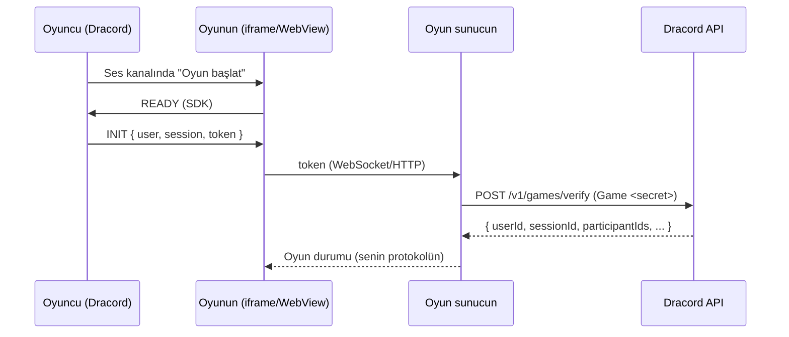

Dracord oyunları, bir **ses kanalının içinde** açılan web oyunlarıdır. Kanaldaki herkes tek tıkla katılır,
konuşmaya devam ederken birlikte oynar. Oyunun web, desktop (Windows/macOS/Linux) ve mobil (iOS/Android)
Dracord uygulamalarında **aynı adresten** çalışır.

<CardGroup cols={2}>
  <Card title="Hızlı başlangıç" icon="rocket" href="/games/quickstart">
    10 dakikada ilk oyununu Dracord'da çalıştır.
  </Card>
  <Card title="Embedded SDK" icon="code" href="/games/sdk">
    `@dracord/embedded-sdk` — kimlik, oturum, oyuncular.
  </Card>
  <Card title="Sunucu doğrulaması" icon="shield-check" href="/games/authentication">
    Token'ı oyun sunucunda doğrula, hileye kapıyı kapat.
  </Card>
  <Card title="Yayın ve inceleme" icon="badge-check" href="/games/publishing">
    Test modu, incelemeye gönderme, yayın kuralları.
  </Card>
</CardGroup>

## Nasıl çalışır?

1. Kullanıcı ses kanalında **🎮 → Oyun başlat** der; Dracord bir **oyun oturumu** açar. Kanaldaki diğerleri **Katıl**'a basar.
2. Oyunun sandbox içinde yüklenir, SDK `ready()` ile Dracord'dan **kimlik ve 10 dakikalık token** alır.
3. Oyun sunucun token'ı Dracord'a doğrulatır; artık oyuncunun kim olduğunu ve hangi oturumda olduğunu bilir.
4. Oyunun gerçek zamanlı trafiği **senin sunucunla** oyuncular arasındadır — Dracord araya girmez, gecikme eklemez.

## Kimler geliştirebilir?

**Herkes.** Ayarlar → Gelişmiş'te geliştirici modunu aç, **Oyunlarım → Yeni oyun**. Taslak oyununu kendin ve
eklediğin **testçiler** hemen gerçek sunucularda deneyebilir. Herkese açılması için **incelemeye gönder** —
yayın kararını Dracord ekibi verir.

<Note>
Dracord'da oynamak oyuncular için her zaman **ücretsizdir**. Oyununu ayrıca Steam vb. mağazalarda satabilirsin;
aynı kodu iki yerde dağıtmak serbesttir.
</Note>

## Sınırlar

| | |
| --- | --- |
| Geliştirici başına oyun | 10 |
| Testçi | 25 |
| Oyuncu / oturum | 1–100 (oyun ayarı) |
| Token ömrü | 10 dk (SDK otomatik yeniler) |
| Adres | `https://` (test için `http://localhost`) |
